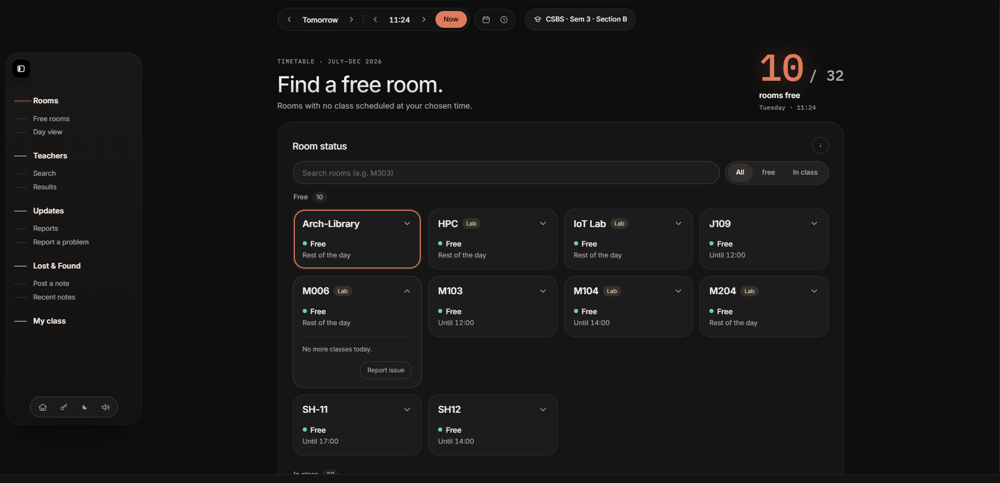
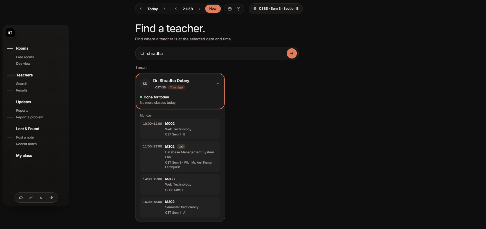
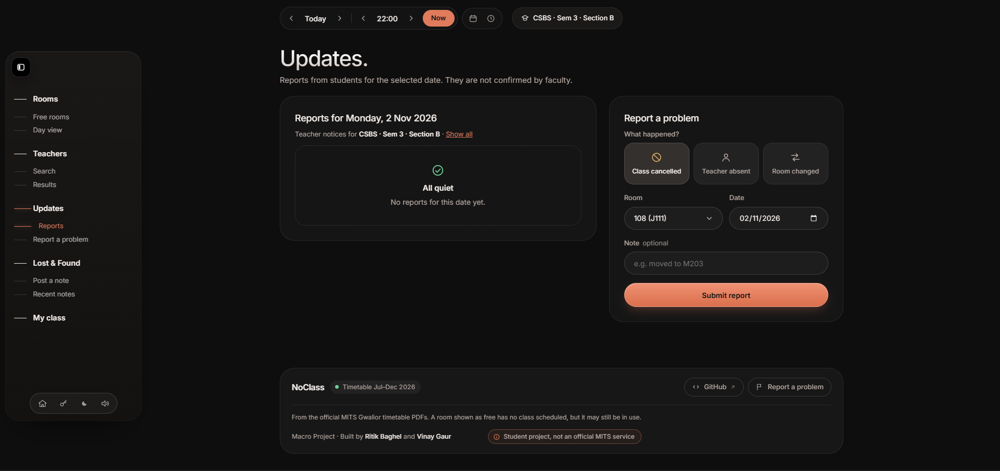
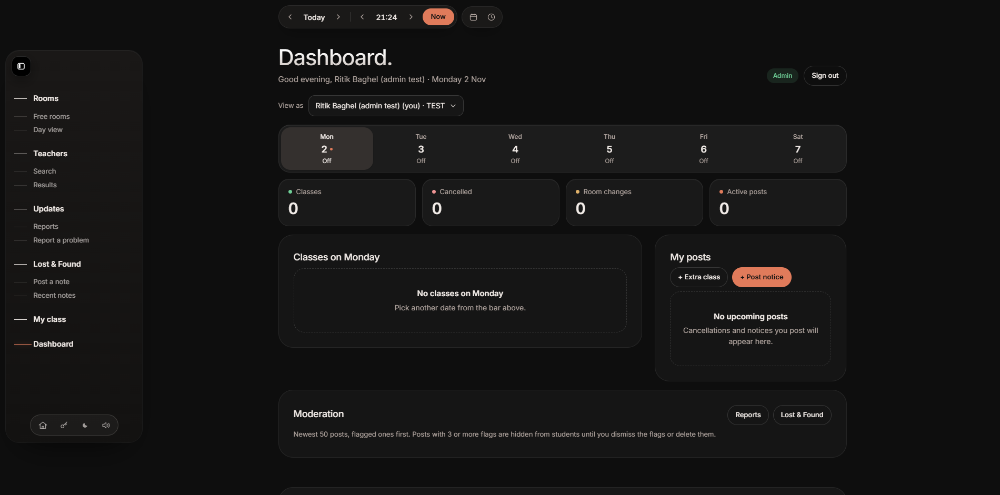
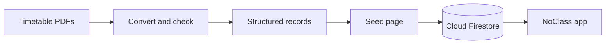
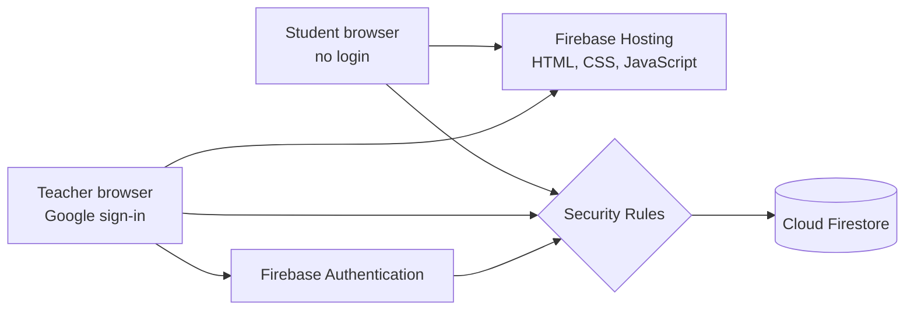

<div align="center">

# NoClass

**Find a free classroom, find your teacher, and see today's changes. No login for students.**

[](https://noclass-mits.web.app)


[Live app](https://noclass-mits.web.app) · [Report a bug](https://github.com/Rit1kk/NoClass/issues)

</div>

> NoClass is a student macro project at Madhav Institute of Technology and Science (MITS), Gwalior. It is not an official MITS service.

## Table of contents

- [Overview](#overview)
- [Features](#features)
- [How it works](#how-it-works)
- [Architecture](#architecture)
- [Tech stack](#tech-stack)
- [Data](#data)
- [Security and privacy](#security-and-privacy)
- [Getting started](#getting-started)
- [Testing and performance](#testing-and-performance)
- [Limitations](#limitations)
- [Roadmap](#roadmap)
- [Team](#team)

## Overview

MITS publishes class timetables as PDF files. A PDF is hard to search, hard to read on a phone and shows one branch at a time, so it cannot answer simple questions such as *which rooms are free at 2 PM?* or *where is this teacher right now?*

NoClass converts the official timetable for the July to December 2026 session into structured data and puts a fast, mobile-friendly web app on top of it. Students use it without an account. Teachers sign in with Google to post verified changes, so students see cancellations and room changes in one place.

## Screenshots

| Rooms | Teacher search |
|---|---|
|  |  |

| Updates | Teacher dashboard |
|---|---|
|  |  |

## Features

### For students (no account needed)

- **Free room finder.** Pick a date and time, or press *Now*, and see which rooms have no class, with the time of the next class in each room. A day view shows the whole day as a timeline.
- **Teacher search.** Find a teacher by name or unique code and see their status, room, subject and the day's classes.
- **Updates.** Student reports and verified teacher notices for the chosen date, in one list.
- **Report a problem.** Report a cancelled class, an absent teacher or a room change.
- **Lost & Found.** Post and filter notes linked to a room.
- **My class.** Save your branch, semester and section on your own device and see your own timetable, teachers and updates first.

### For teachers and admin (Google sign-in, staff list only)

- Cancel a class, change a room, add an extra class or post a notice for a chosen section, semester or branch.
- Room lists show only rooms that are free at that time.
- Every post is marked as verified and is saved under the teacher's own code. Past dates are locked.
- Undo or delete your own posts.
- The admin can view the dashboard as another teacher for demos and tests.

## How it works



**The availability rule.** A room is busy from the start time of a class up to, but not including, its end time. At a chosen time, a room with no such class is free. Teacher posts then adjust the result:

1. A cancelled class frees its room if the teacher chooses *show room as free*.
2. A room change moves the class to the new room.
3. An extra class makes its room busy at that time.

A room shown as free means that **no class is scheduled**. It does not guarantee that the room is empty. Student reports and verified notices reduce this risk.

## Architecture

NoClass is serverless. There is no server of our own: the browser loads the pages from Firebase Hosting and talks directly to Firebase services. Security rules decide what each person may do.



Each search reads only one day of timetable data, and the class list is cached on the device to keep reads small.

## Tech stack

| Layer | Technology |
|---|---|
| Front end | HTML, CSS and JavaScript modules (no framework, no build step) |
| Database | Cloud Firestore |
| Hosting | Firebase Hosting |
| Authentication | Firebase Authentication (Google sign-in, staff only) |
| Access control | Firestore Security Rules |
| Tools | Git, GitHub, Node.js, Chrome DevTools, Lighthouse |

## Data

The live data covers **32 rooms and labs, 71 teachers and 568 scheduled classes** across eight branches: AI, AIR, AIDS, AIML, IoT, CST, CSBS and ECE (semesters 1, 3 and 5 where available).

| Collection | Purpose |
|---|---|
| `rooms` | Classrooms and labs |
| `teachers` | Teachers, each with a unique code |
| `timetable` | Scheduled classes: day, start and end time, room, subject, branch, semester, section and teacher codes |
| `reports` | Student reports about a room or class |
| `lostFound` | Lost & Found notes linked to a room |
| `staff` | Accounts allowed to use the teacher dashboard (document ID is the lowercase email) |
| `notices` | Verified teacher posts: cancellations, room changes, extra classes and notices |

Rooms and timetable are separate records linked by room ID, so a new building or branch needs only new data and no code change.

## Security and privacy

- **Security rules.** The public can read the timetable and add reports and Lost & Found notes, but cannot edit or delete them. Only staff can post notices, and only under their own teacher code.
- **Escaped text.** All text typed by users is escaped before it is shown, which prevents script injection.
- **Staff-only sign-in.** Only Google accounts on the staff list get the dashboard.
- **No student accounts and no location tracking.** The saved class stays in the student's own browser.
- **Note.** The class filter is meant for relevance, not secrecy. Notices are not private data.

## Getting started

### Prerequisites

- A modern browser
- Node.js (for a local web server and the unit tests)
- Git
- A Firebase project, if you want to run your own copy

### Run locally

The app uses JavaScript modules, so it must be opened through a local web server. Opening the file by double-clicking gives a CORS error.

```bash
git clone https://github.com/Rit1kk/NoClass.git
cd NoClass
npx serve
```

You can also use `python -m http.server 8000`. Then open the address shown in the terminal.

### Set up your own copy

1. Create a Firebase project and turn on **Cloud Firestore**, **Firebase Hosting** and **Firebase Authentication** (Google sign-in).
2. Put your project's web settings in `firebase-config.js`.
3. Publish the Firestore security rules.
4. Sign in as the admin account on `seed.html` and load the rooms, teachers and timetable. Document IDs are fixed, so loading again does not create duplicates.
5. Add staff accounts to the `staff` collection with the fields `email`, `teacherCode`, `name` and `role` (`teacher` or `admin`).
6. Deploy:

```bash
firebase deploy --only hosting
```

### Key files

| File | Purpose |
|---|---|
| `index.html` | Landing page |
| `app.html` | The app: student screens and the teacher dashboard |
| `seed.html` | Admin-only data loader |
| `firebase-config.js` | Firebase web settings |

## Testing and performance

| Level | What it checks | Result |
|---|---|---|
| Unit | Availability rule, teacher matching and data integrity, using a Node.js script on the full timetable | 16 of 16 passed |
| Integration | App and Firestore working together | 6 of 6 passed |
| System | Complete tasks in the browser | 4 of 4 passed |
| Security | Security rules, text escaping and sign-in | 8 of 8 passed |

Nine bugs were found during testing and all were fixed, including a script-injection bug in user notes and two teachers sharing one code.

**Performance.** Lighthouse on 12 October 2026 gave a performance score of **99 on desktop** and **85 on mobile**, with first and largest contentful paint of 0.7 seconds on desktop.

## Limitations

- The app works from the timetable only. There are no room sensors, room booking or push notifications.
- Updates depend on teachers and students posting them.
- The timetable must be reloaded with the seed page when the official timetable changes.
- Firebase free plan limits apply.

## Roadmap

- [ ] Push notifications for cancellations and room changes
- [ ] Automatic removal of old notices after their expiry date
- [ ] A way to confirm that a free room is really empty, such as student check-in
- [ ] An upload tool that reads a new timetable file directly
- [ ] More semesters, branches and buildings
- [ ] An installable version that works offline

## Team

- **Ritik Baghel** ([@Rit1kk](https://github.com/Rit1kk))
- **Vinay Gaur** 

**Mentor:** Dr. Shradha Dubey, MITS Gwalior

Timetable data comes from the official class timetables published by MITS Gwalior for the July to December 2026 session.
